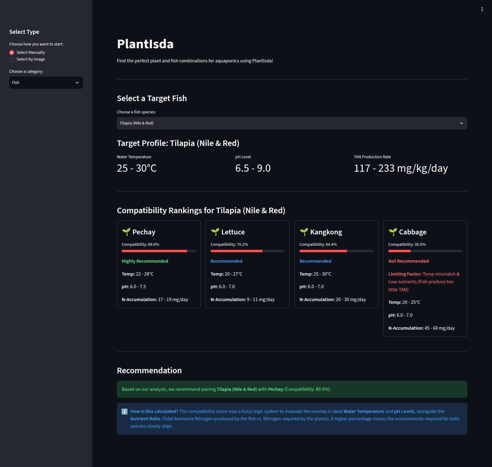

# PlantIsda

A Streamlit application for exploring fish and plant pairings in aquaponics. PlantIsda ranks combinations using fuzzy logic over temperature overlap, pH overlap, and the ratio of fish ammonia production to plant nitrogen requirements.

## Screenshot



This screenshot shows manual selection in dark mode with the application's built-in species data. Optional camera capture is omitted from the screenshots.

## Features

- Start with a fish or a plant and rank the available pairings.
- Compare temperature, pH, and nutrient profiles alongside compatibility scores.
- See recommendation tiers and limiting factors for weaker pairings.
- Explore four fish profiles: tilapia, hito/catfish, common carp, and koi/goldfish.
- Explore four plant profiles: pechay, lettuce, kangkong, and cabbage.
- Upload a PNG/JPEG or use an optional camera input for YOLO-based plant detection.
- Run locally in a browser, with an optional launcher that opens the app automatically.

The image workflow maps model labels to the four plant profiles. Recognition depends on the classes in `yolo26n.pt`; detections without a matching profile produce a message instead of a compatibility ranking. It does not identify fish from images.

## Requirements

- Python 3.12 and `uv` for the installation commands below.
- A modern web browser.
- The bundled `yolo26n.pt` file for image detection. Manual selection does not load the model.
- Camera permission only if you choose **Take Picture**. Uploading a file and manual selection do not need camera access.

The app uses Streamlit, NumPy, SciPy, scikit-fuzzy, Pillow, and Ultralytics. The installation also supplies NetworkX and Matplotlib for scikit-fuzzy's control system. CPU PyTorch is sufficient.

## Installation

```bash
git clone https://github.com/LedgeA/PlantIsda.git
cd PlantIsda
uv venv --python 3.12 .venv
uv pip install torch torchvision --index-url https://download.pytorch.org/whl/cpu
uv pip install -r requirements.txt networkx matplotlib
```

## Usage

Activate the environment from the repository root and start Streamlit:

```bash
# Linux / macOS
source .venv/bin/activate
python -m streamlit run app.py
```

```powershell
# Windows PowerShell
.\.venv\Scripts\Activate.ps1
python -m streamlit run app.py
```

Open `http://localhost:8501`. To use the launcher after activating the environment, run `python launcher.py`; it starts the server on port 8501 and opens your browser.

### Manual selection

1. Select **Select Manually** in the sidebar.
2. Choose **Fish** or **Plant**.
3. Select a species to view its profile and ranked pairings.
4. Read the scores, recommendation tiers, and any limiting factors.

### Image selection

1. Select **Select by Image**.
2. Choose **Upload File** and select a PNG/JPEG, or choose **Take Picture** and grant camera permission.
3. The app runs the bundled YOLO model and uses the first detection to look up a plant profile.
4. When a label matches the database, the app shows compatible fish. Otherwise, it reports an unmatched label or no detection.
